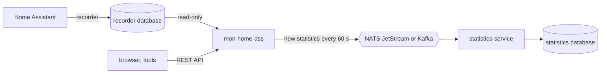

# mon-home-ass

Readonly HTTP API over a Home Assistant recorder database. Exposes
statistics, entities, states, a sensor catalog and, under `/raw`, the recorder internals
(recorder/statistic runs, migrations, events, schema changes) as JSON
endpoints for external tools/dashboards, without touching Home Assistant
itself.

## Stack

Kotlin + Ktor server, Exposed ORM against the recorder DB — Postgres,
MariaDB, MySQL, or SQLite, selected via `ktor.database.database_type`
(Postgres/H2 in tests via Testcontainers) — Redis (Jedis) as a 5-minute
read-through cache, kotlinx.serialization, Ktor's built-in
OpenAPI/`swaggerUI` for the live API docs.

## Getting started

Start the server on `http://localhost:8080`. The database comes from `ktor.database` in
`src/main/resources/application.yaml`, set through `DB_TYPE` (`postgres`, `mariadb`, `mysql`, `sqlite`), `DB_URL`
(`host:port`), `DB_NAME`, `DB_USER`, `DB_PASSWORD` and `DB_DRIVER`; `sqlite` reads the file at `DB_FILE_PATH`
instead:

```bash
./gradlew run
```

Compile and run the tests (Testcontainers, so Docker must be running):

```bash
./gradlew build
```

Swagger UI: `http://localhost:8080/swagger`

Cross-origin browser calls are allowed only from the hosts in `CORS_HOSTS`: comma-separated, without scheme (`http`
and `https` both match), e.g. `statistics.home.arpa,localhost:8081`; default `localhost:8080`, empty = no
cross-origin access.

Health probes: `/health/ready` answers 503 while the database is unreachable, `/health/live` stays 200.

## Sensor catalog

`GET /sensors` lists one sensor per row of `statistics_meta` with a human `name`, `area`, `floor`, `category` and
`unit`, optionally filtered by exact `area` and `category`. It is built from the recorder database (the latest
`friendly_name`, `device_class` and `unit_of_measurement` of each entity, then `statistics_meta`) and cached like
every other read.

- name: `friendly_name`, else the `statistics_meta` name, else the entity id without its domain (`sensor.kitchen_co2`
  → `Kitchen co2`); repeated names get ` 2`, ` 3`, ... in entity id order
- category: from `device_class` (`climate`, `air-quality`, `energy`, `utility`, `battery`, `light`, `diagnostic`),
  else from the `statistics_meta` unit class, else `other`

## Statistics publisher

Optionally the app feeds statistics-service: every `PUBLISH_INTERVAL_SECONDS` it reads new rows of
`statistics_short_term` (Home Assistant's 5-minute statistics) and publishes them to NATS JetStream or Kafka.
statistics-service takes them as the `pubsub` source `home-assistant` and stores them as records.



| Env | Default | Meaning |
| --- | --- | --- |
| `PUBLISHER` | `none` | `none`, `jetstream` or `kafka`; anything else stops the start |
| `SOURCE_ID` | `home-assistant` | statistics-service source id: the NATS subject is `<NATS_SUBJECT_PREFIX>.<id>`, the Kafka record key is the id |
| `SOURCE_TOKEN` | not set | the source token, sent as `Authorization: Bearer <token>`; without it the publisher stays off |
| `PUBLISH_INTERVAL_SECONDS` | `60` | how often to look for new rows |
| `PUBLISH_LOOKBACK_MINUTES` | `60` | after a start, rows of the last N minutes are sent again |
| `NATS_URL` | `nats://localhost:4222` | with `jetstream` |
| `NATS_USER`, `NATS_PASSWORD` | not set | NATS credentials |
| `NATS_INBOX_PREFIX` | `_INBOX` | inbox for JetStream acks; must match the user's subscribe permission |
| `NATS_SUBJECT_PREFIX` | `stats.ingest` | same as `NATS_SUBJECT_PREFIX` of statistics-service |
| `KAFKA_BOOTSTRAP_SERVERS` | `localhost:9092` | with `kafka` (plaintext, no SASL) |
| `KAFKA_TOPIC` | `stats.ingest` | same as `KAFKA_TOPIC` of statistics-service |

One message carries one row in the native record format of statistics-service:

```json
{"ts": "2026-11-03T10:00:00Z", "dims": {"statistic_id": "sensor.living_room_temperature"}, "vals": {"mean": 21.4, "min": 21.1, "max": 21.8}}
```

- The publisher waits for the broker's ack (JetStream stream ack, Kafka `send().get()`) before the next row. When
  sending fails, the next round starts at that row; nothing is skipped.
- The position lives only in memory, so after a restart the last `PUBLISH_LOOKBACK_MINUTES` are sent again.
  statistics-service drops the repeats: the source mapping has `identity` = `statistic_id` + `ts`.
- The publisher never creates or reads streams or topics: statistics-service creates the stream `STATS_INGEST` on
  start (JetStream), and a NATS user only needs publish on its subject plus subscribe on its inbox.
- The receiving side (dataset, source with mapping, dashboard):
  [statistics-service `definitions/home-assistant.json`](https://github.com/jagieloadrian/statistics-service/blob/main/definitions/home-assistant.json).
  Homelab setup: `.devops/README.md`.

## Docs

- API contract — generated from route `.describe {}` blocks, not hand-maintained. Live at `/openapi.json` (raw) or `/swagger` (UI) on a running instance.
- `.devops/` — Flux HelmRelease (shared homelab-infra chart `charts/app`), see `.devops/README.md`
